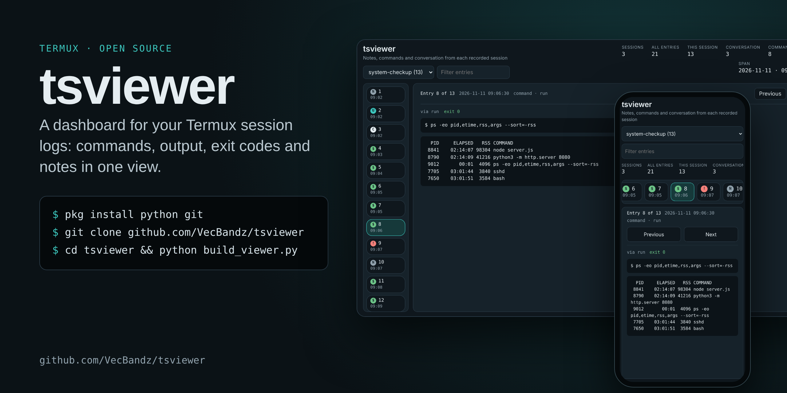

# tsviewer



▶ **[Watch the 30-second demo](https://www.facebook.com/reel/984946424171982)**: install, launch and tour on a real phone.

**tsviewer is a dashboard for your Termux session records.** Log the commands you run, their output and exit codes, plus your own notes, then open one page that shows each session as a numbered timeline you can filter and step through. It works on your phone and on a desktop browser.

- **Session picker.** Each `logs/<name>.jsonl` file is its own session.
- **Stats bar.** Shows sessions, entries, conversation turns, commands, failed commands and the time span.
- **Numbered rail.** `$` marks a command that passed, `!` a failed one, `N` a note, and `U`/`C` user and assistant turns.
- **Reader.** Shows the full command, stdout and stderr (stderr in red) and the exit code.
- **Filter box.** Searches every field.
- **Keys.** ↑/↓ or j/k move between entries.
- **Theme.** Light and dark follow your system setting.
- **Single file.** `viewer.html` is self-contained (no internet or install needed), so you can share it or keep it as a record.

## Install in Termux

```sh
pkg install -y python git
git clone https://github.com/VecBandz/tsviewer ~/tsviewer
cd ~/tsviewer
```

No git? Download **tsviewer.zip** from the [latest release](https://github.com/VecBandz/tsviewer/releases/latest) and run:

```sh
pkg install -y python unzip
termux-setup-storage                     # once, so Termux can read Downloads
unzip ~/storage/downloads/tsviewer.zip -d ~ && cd ~/tsviewer
```

## Launch

```sh
python build_viewer.py      # builds viewer.html and opens it in your browser
```

To see it with sample data first:

```sh
cp examples/*.jsonl logs/ && python build_viewer.py
```

## Log your sessions

```sh
python tlog.py note my-session "Goal: clean up storage"
python tlog.py note my-session "User: what's using space?"   # "User:" / "Claude:" show as conversation turns
python tlog.py run  my-session -- df -h                      # runs it and logs the command, output and exit code
python build_viewer.py                                       # rebuild and open
```

Logs live in `logs/<session>.jsonl`, one JSON event per line. Nothing is captured automatically. An entry is added only when you call `tlog.py`.

### Running from a proot-distro guest

`tlog.py ssh` runs commands in Termux over SSH. Edit `SSH_ARGS` at the top of `tlog.py` (for example `["-p", "8022", "localhost"]`). Then, in Termux, run `pkg install openssh` and start `sshd`.

## Files

| File | What it does |
|---|---|
| `tlog.py` | Appends notes and command results to `logs/<session>.jsonl` |
| `build_viewer.py` | Bundles every log into `viewer.html` and opens it in your browser via a local-only server on `127.0.0.1:8765` (use `--no-open` to just build) |
| `TSViewer.html` | The dashboard page (`build_viewer.py` fills in the data) |
| `examples/` | Sample sessions for trying it out |

The page loads fonts from Google Fonts. Offline, it falls back to system fonts.
